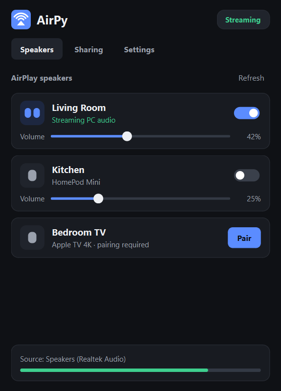
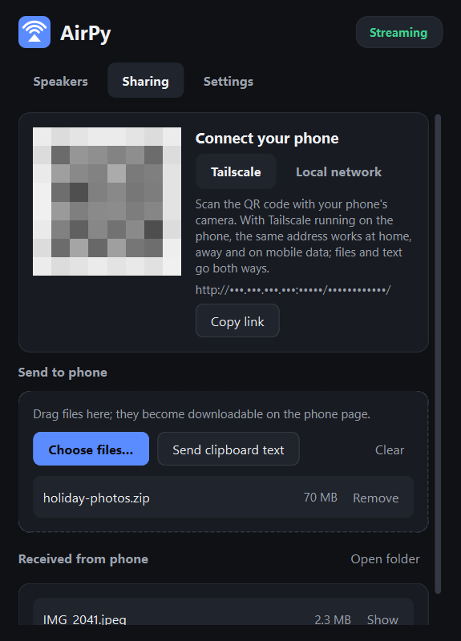
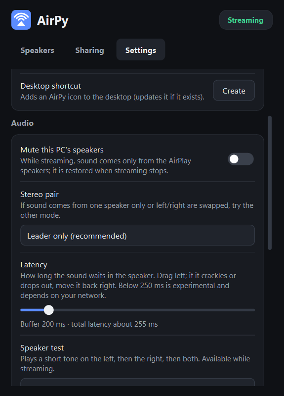

# AirPy

[Türkçe](README.tr.md) · English

Stream your **Windows PC's audio to AirPlay speakers** (HomePod, HomePod mini, stereo pairs, Apple TV and
other AirPlay receivers) and **trade files with your phone** over your network or Tailscale. It has a
windowed UI, lives in the system tray and starts with Windows. An optional **Edge/Chromium extension** delays
video by the speaker latency so picture and sound stay in sync.

<p align="center">
  
  
  
</p>

> **Status: early (0.1.x).** It was built and tested on one Windows 11 PC with a HomePod mini stereo pair.
> Other receivers (Apple TV, AirPlay TVs, third‑party speakers) are expected to work but are untested.
> The interface is currently **Turkish only** — translations are welcome (see [CONTRIBUTING](CONTRIBUTING.md)).

## Features

- **PC audio to AirPlay** – everything Windows plays (browser, games, music) is captured with WASAPI loopback
  and sent to the speakers you switch on. No virtual audio driver needed.
- **Stereo pairs** – two paired HomePods appear as one row.
- **Volume control** – per speaker, also while nothing is streaming.
- **Low latency** – adjustable speaker buffer from 50 ms to 1.5 s (default setting 1.5 s is the safest).
- **Runs quietly** – tray icon, optional start with Windows, reconnects automatically when the connection drops.
- **Pairing** – receivers that ask for a PIN get a *Pair* button (implemented, untested on real hardware).
- **Phone file sharing** – scan a QR code on your phone; send photos/files/text to the PC and download files
  you drag into the window. Works over Tailscale from any network.
- **Edge extension (AirPy Sync)** – delays video frames by the stream latency so lips match audio.

## Requirements

- Windows 10/11 (uses WASAPI, the registry and the Windows tray; not portable to macOS/Linux)
- Python 3.12–3.14 from [python.org](https://www.python.org/downloads/) (developed on 3.14)
- AirPlay receivers on the same network as the PC. For HomePods set *Home app → Home Settings → Speakers & TV →
  Allow Speaker & TV Access* to **Anyone on the same network** and turn the password off.

## Install

1. Download the source (Releases page ZIP, or `git clone`).
2. Double‑click **`install.bat`** – creates `.venv` and installs the dependencies (optionally adds a desktop shortcut).
3. Double‑click **`AirPy.bat`** to start.

If Windows Firewall asks, allow Python on **private and public networks**: the speakers' timing packets and
the phone page need inbound connections.

To remove it run **`uninstall.bat`** (stops the app, removes the autostart entry and the shortcut; asks before it
deletes settings or `.venv`). `shortcut.bat` recreates the desktop shortcut.

## Use

Open the **Speakers** tab and switch a speaker on. After a few seconds it says *streaming*. Closing the window
keeps the app in the tray; use the tray menu to quit.

**Latency.** AirPlay buffers audio on the speaker, so sound arrives later than the picture. Total delay is the
speaker buffer you choose plus about 55 ms on the PC side. For music it does not matter. For video either lower
the buffer in *Settings → Latency* or use the browser extension below.

### Phone file sharing

The **Sharing** tab shows a QR code. Scan it with your phone's camera; the page that opens lets you send files
and text to the PC (saved to `Downloads\AirPy`) and download what you add from the PC. If Tailscale is running on
both devices the QR uses the PC's Tailscale address so it works from any network. For a share‑sheet entry on
iOS the page explains how to build a small Shortcut (*Share → Send to AirPy*).

This is **not real AirDrop**: AirDrop needs Apple's AWDL Wi‑Fi layer, which Windows does not have, so the PC
never appears in the AirDrop sheet.

### Edge extension – picture/sound sync

Because audio leaves the PC live it cannot be advanced, but video can be delayed by the same amount.

1. Open `edge://extensions`, enable *Developer mode*, choose **Load unpacked** and select the `extension` folder.
2. Switch a speaker on in AirPy and play a video. The badge on the extension icon shows the applied delay (ms).
3. Fine‑tune with the extension's **Sync test** (a light flashes while a beep plays – move the slider until
   they coincide).

How it works: the extension asks AirPy (`127.0.0.1`, loopback only) for the current latency, then captures the
video with `captureStream()` and shows the frames on a canvas after that delay. It requests no access to any
site except `http://127.0.0.1`. Limits: **DRM‑protected video** (Netflix, Disney+, Prime Video) cannot be
captured; video calls (WebRTC) are skipped on purpose; fullscreen on the `<video>` element itself and
Picture‑in‑Picture stay undelayed; delayed frames use up to ~320 MB of memory. It is written for Chromium
browsers and was verified on a test page, but not yet from a real browser install.

## Settings

| Setting | What it does |
| --- | --- |
| Start with Windows | Adds/removes `HKCU\...\Run` (current user only). |
| Auto‑connect | Starts streaming to the speakers that were on when the app last ran. |
| Mute this PC's speakers | Mutes the default output while streaming, restores it afterwards. |
| Stereo pair | *Leader only* sends to the pair leader; *Both speakers* opens one stream per HomePod. Try the other if sound comes from one side. |
| Latency | Speaker buffer, 50–1500 ms. Below ~250 ms is experimental and depends on your network. |
| Speaker test | Plays a short left → right → both tone (needs an active stream). |
| Phone file sharing / folder | Enables the web page; folder for received files. |

Settings and log live in `%APPDATA%\AirPy` (`config.json`, `airpy.log`).

## Troubleshooting

| Symptom | Try |
| --- | --- |
| No speakers listed | PC and speakers must be on the same, non‑isolated network. Press *Refresh*. |
| "Speaker did not respond" | Allow Python in the firewall; check the Home app access setting above. If a VPN (Tailscale, WARP) is installed AirPy already binds to the physical NIC; make sure your Ethernet/Wi‑Fi has an IPv4 address. |
| Connected but silent | Play something on the PC; the level bar should move. Raise the speaker volume slider. |
| Sound from one speaker only | *Settings → Stereo pair*, then the speaker test. |
| Crackling / dropouts | Raise the latency slider; use Ethernet. |
| Phone page does not open | Same network (or Tailscale on both); check the firewall. |

## How it works

```
Windows audio ──WASAPI loopback──▶ audio.py ──▶ Timeline (shared clock)
                                                   │ read by absolute sample position
                                                   ▼
                                    airplay.py (pyatv RAOP / AirPlay 2)
                                                   ▼
                                       HomePod / stereo pair
```

- `airpy/audio.py` – captures the default output, resamples to 44.1 kHz stereo and writes it to a ring buffer
  addressed by absolute sample position; sound‑card clock drift is corrected by dropping/repeating one sample
  per block, so streams to several speakers stay locked.
- `airpy/airplay.py` – feeds that live source straight into [pyatv](https://github.com/postlund/pyatv)'s RTP
  stream (skipping its file decoding), plus discovery, pairing and idle volume control.
- `airpy/net.py` – binds connections to the physical NIC on the speaker's subnet (VPN routes otherwise break
  AirPlay's UDP channels) and publishes `airpy.local`.
- `airpy/share.py`, `airpy/web/` – phone page and file server (aiohttp). `airpy/localapi.py` – loopback API
  for the extension. `airpy/engine.py` – background asyncio engine. `airpy/ui/`, `airpy/app.py` – PySide6 UI.
- `extension/` – Manifest V3 browser extension.

## Security and privacy

- No telemetry, no cloud: everything stays on your network.
- The phone page is plain HTTP; access is protected by a random secret in the URL (QR code). Use trusted
  networks or Tailscale. Anyone who has the URL can send files to your Downloads folder – reset by deleting
  `share_token` in `config.json`.
- The extension API listens on `127.0.0.1` only, sends no CORS headers, rejects web‑page origins and
  validates the `Host` header.
- Pairing credentials, if you pair a device, are stored in `config.json`.

Report vulnerabilities as described in [SECURITY.md](SECURITY.md).

## Contributing

Issues and pull requests are welcome – see [CONTRIBUTING.md](CONTRIBUTING.md). Run the checks with
`pip install -r requirements-dev.txt`, `ruff check .`, `pytest`.

## Credits and legal

Built on [pyatv](https://github.com/postlund/pyatv) (AirPlay), [PyAudioWPatch](https://github.com/s0d3s/PyAudioWPatch)
(WASAPI loopback), [PySide6](https://pypi.org/project/PySide6/), [python-soxr](https://github.com/dofuuz/python-soxr),
[pycaw](https://github.com/AndreMiras/pycaw), [aiohttp](https://github.com/aio-libs/aiohttp),
[python-zeroconf](https://github.com/python-zeroconf/python-zeroconf), [qrcode](https://github.com/lincolnloop/python-qrcode)
and NumPy. Thanks also to the AirDrop reverse‑engineering work at [OpenDrop](https://github.com/seemoo-lab/opendrop)
and [winawdl](https://github.com/raph559/winawdl), which explain why real AirDrop is out of reach here.

Licensed under the [MIT License](LICENSE). AirPy is an independent project and is **not affiliated with, endorsed
by or sponsored by Apple Inc.** AirPlay, AirDrop, HomePod, Apple TV and iPhone are trademarks of Apple Inc.
