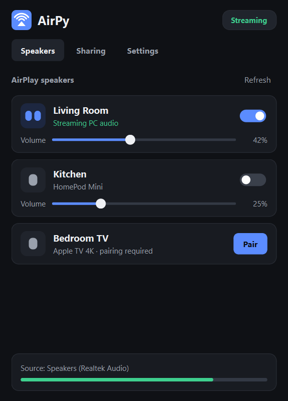
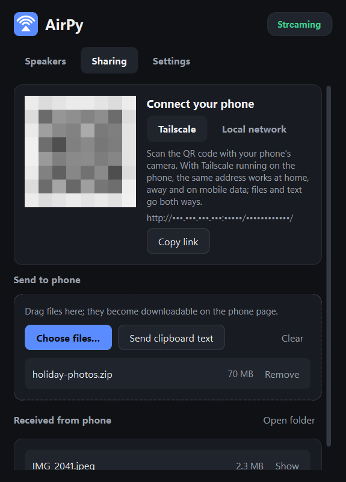
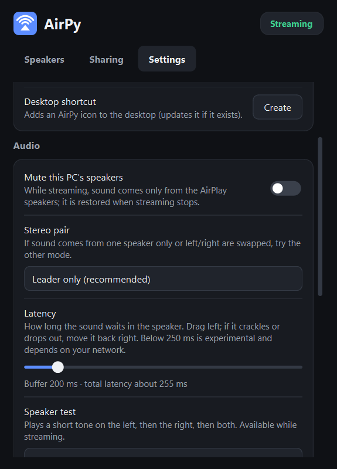

# AirPy

Türkçe · [English](README.md)

<p align="center">
  
  
  
</p>

> **Durum: erken sürüm (0.1.x).** Tek bir Windows 11 bilgisayarda, HomePod mini stereo çiftiyle geliştirildi
> ve denendi. Diğer alıcılar (Apple TV, AirPlay'li televizyonlar, üçüncü taraf hoparlörler) beklenen şekilde
> çalışmalı ama denenmedi. Arayüz şimdilik yalnızca Türkçedir.

Windows bilgisayarın sesini AirPlay hoparlörlerine (HomePod, HomePod mini, stereo çiftler, Apple TV,
AirPlay destekli diğer hoparlörler) aktaran ve telefonla AirDrop benzeri dosya alışverişi sağlayan
Python uygulaması. Pencereli bir arayüzü vardır, sistem tepsisinde çalışır ve Windows açılışında
kendiliğinden başlar.

## Özellikler

- **Bilgisayar sesini aktarma** – Windows'ta çalan her şey (tarayıcı, oyun, müzik) WASAPI loopback ile
  yakalanır ve seçilen hoparlörlere gönderilir. Sanal ses sürücüsü gerekmez.
- **Stereo çift desteği** – Aynı çifte ait iki HomePod tek satır olarak görünür.
- **Ses seviyesi** – Hoparlörün sesi uygulamadan ayarlanır; aktarım kapalıyken de çalışır.
- **AirPlay'li TV ve diğer cihazlar** – Ses alabilen her AirPlay cihazı listelenir. Kod isteyen
  cihazlarda **Eşleştir** düğmesiyle ekrandaki kod girilir; eşleştirme bir kez yapılır.
- **Otomatik başlatma ve bağlanma** – Oturum açılınca tepside başlar, son seçilen hoparlörlere
  kendiliğinden bağlanır; bağlantı koparsa yeniden dener.
- **Telefonla dosya paylaşımı** – QR kodu okutunca açılan sayfadan bilgisayara fotoğraf/dosya/metin
  gönderilir; bilgisayardan sürüklenen dosyalar telefona indirilir. Telefona uygulama kurmak gerekmez.

## Kurulum ve çalıştırma

1. `install.bat` – sanal ortamı (`.venv`) oluşturur, bağımlılıkları yükler (Python 3.12–3.14 gerekir).
2. `AirPy.bat` – uygulamayı başlatır.

Diğer betikler:

| Betik | Ne yapar |
| --- | --- |
| `shortcut.bat` | Masaüstüne AirPy kısayolu ekler (Ayarlar › Masaüstü kısayolu düğmesi de aynısını yapar). |
| `uninstall.bat` | Çalışan uygulamayı kapatır, Windows açılış kaydını ve masaüstü kısayolunu siler. Ayarları ve `.venv` klasörünü silmeden önce sorar; telefondan gelen dosyalara dokunmaz. |

İlk açılışta Windows Güvenlik Duvarı izin sorarsa **özel ve ortak ağlar için izin verin**; hoparlörün
zamanlama paketleri ve telefon sayfası bilgisayara gelen bağlantılara ihtiyaç duyar.

## Kullanım

**Hoparlörler** sekmesinde hoparlörün yanındaki anahtarı açın. Birkaç saniye içinde durum
“Bilgisayar sesi aktarılıyor” olur. Pencereyi kapatmak uygulamayı kapatmaz; tepsi simgesinden
açılır, tamamen kapatmak için tepsi menüsünde **Çıkış** kullanılır.

HomePod görünmüyor ya da “erişim” hatası veriyorsa iPhone'da **Ev › Ev Ayarları › Hoparlörler ve TV**
bölümünde erişimi **Aynı ağdaki herkes** yapın ve parola istemeyi kapatın.

**Paylaşım** sekmesindeki QR kodu iPhone kamerasıyla okutun. Sayfayı ana ekrana eklerseniz tekrar
okutmanız gerekmez. Gelen dosyalar `İndirilenler\AirPy` klasörüne kaydedilir (Ayarlar'dan değişir).

### Edge eklentisi: görüntü ve ses senkronu

AirPlay sesi hoparlörde tamponlandığı için video izlerken ses görüntünün gerisinde kalır. Sesi
öne çekemeyiz (canlı), ama **görüntüyü aynı miktarda geciktirebiliriz**. `extension` klasöründeki
**AirPy Senkron** eklentisi bunu yapar:

1. `edge://extensions` › sağ alttan **Geliştirici modu**'nu aç › **Paketlenmemiş öğe yükle** ›
   proje içindeki `extension` klasörünü seç. (AirPy › Ayarlar › Tarayıcı eklentisi › *Klasörü aç*
   klasörü gösterir.)
2. AirPy'de aktarımı aç. Eklenti, AirPy'nin yerel API'sinden (`127.0.0.1`, dışarıdan erişilemez)
   toplam gecikmeyi okur ve oynayan videoların karelerini o kadar bekletir. Aktarım kapanınca ya
   da video sessize alınınca gecikme kendiliğinden kalkar.
3. Kalan farkı kulakla kapatmak için eklenti simgesindeki **Senkron testi**'ni aç: her saniye ekran
   bir kez beyaz yanar ve aynı anda bip çalar. Işık bipten önce geliyorsa **İnce ayar**'ı artır,
   sonra geliyorsa azalt.

Eklentinin açılır penceresinde ana anahtar, *Otomatik/Elle* seçimi (Elle: AirPy olmadan sabit süre,
ör. Bluetooth hoparlör) ve site bazında kapatma vardır; rozetteki sayı uygulanan gecikmedir (ms).

Sınırlar: Netflix, Disney+, Prime Video gibi **DRM korumalı videolar** yakalanamaz, bunlara
gecikme uygulanmaz. Video tam ekranda `<video>` öğesinin kendisi tam ekrandaysa ya da resim içinde
resim (PiP) kullanılıyorsa görüntü gecikmesiz kalır. Görüntülü aramalar (WebRTC) bilerek atlanır.
Gecikmeli kareler bellekte tutulur (üst sınır ~320 MB; gecikme büyüdükçe kare hızı düşer). Yalnızca
müzik dinlerken eklentiye gerek yoktur.

### Farklı ağlardan paylaşım (Tailscale)

Bilgisayarda Tailscale açıksa Paylaşım sekmesinde **Tailscale / Yerel ağ** seçimi çıkar ve QR kod
varsayılan olarak bilgisayarın Tailscale adresini (`100.x.y.z`) gösterir. Telefonda da aynı
Tailscale hesabı açıkken bu adres evde, dışarıda ve mobil veride çalışır; Tailscale adresi cihaza
sabit atandığı için yer imi ve Paylaş menüsü kestirmesi de bozulmaz. Tailscale kapalıysa uygulama
kendiliğinden yerel ağ adresine döner.

### iPhone'un Paylaş menüsünden gönderme

Telefon sayfasının altındaki **Paylaş menüsüne “AirPy’ye Gönder” ekle** bölümü, Kestirmeler
uygulamasında bir kez kurulacak kısa bir kestirmeyi adım adım anlatır ve yapıştırılacak adresi
verir. Kurulduktan sonra herhangi bir uygulamada **Paylaş › AirPy’ye Gönder** dosyayı doğrudan
bilgisayara yollar. Bilgisayar AirDrop satırında değil, Paylaş menüsündeki eylemler arasında görünür.

Uygulama yerel ağda `airpy.local` adını yayınlar; telefon bu adı çözebiliyorsa sayfa kestirme için
onu önerir, böylece bilgisayarın IP'si değişse de kestirme çalışmaya devam eder.

### Eşleştirme

Kod isteyen cihazlarda (ör. bazı Apple TV ve AirPlay'li televizyonlar) satırda anahtar yerine
**Eşleştir** düğmesi çıkar. Basınca cihaz ekranında bir kod görünür; kodu girdikten sonra kimlik
bilgisi `config.json` içinde saklanır ve bir daha sorulmaz.

### Ayarlar

| Ayar | Açıklama |
| --- | --- |
| Windows açılışında başlat | `HKCU\...\Run` altına kayıt ekler/kaldırır (yalnızca geçerli kullanıcı). |
| Seçili hoparlörlere otomatik bağlan | Açılışta son açık bırakılan hoparlörlere aktarımı başlatır. |
| Bilgisayarın hoparlörünü sustur | Aktarım sırasında PC hoparlörünü sessize alır, bitince geri açar. |
| Stereo çift | *Yalnızca lider*: ses çiftin lider hoparlörüne gönderilir. *İki hoparlöre ayrı akış*: her iki HomePod'a eş zamanlı ayrı akış açılır. Ses tek hoparlörden geliyorsa diğer modu deneyin. |
| Gecikme | Hoparlör tamponu (50–1500 ms kaydırıcı). Sola çektikçe gecikme azalır; ses cızırdar ya da kesilirse biraz sağa alın. 250 ms altı deneyseldir. |
| Hoparlör testi | Sol → sağ → ikisi sırasıyla kısa ton çalar; stereo çiftin doğru çalıştığını kulakla doğrulamak içindir. |

## Bilinen sınırlar

- **Gecikme**: AirPlay sesi hoparlörde tamponlar; sıfıra inmez. Toplam gecikme = hoparlör tamponu
  (ayarlanır) + yaklaşık 55 ms (PC tarafı: 10 ms'lik yakalama blokları ve 40 ms okuma payı).
  Tampon 200 ms iken toplam yaklaşık 255 ms olur. Hoparlörün temiz çalabildiği en düşük tampon
  ağa ve cihaza bağlıdır; kulakla bulunur. Video için kalan farkı oynatıcının ses gecikmesi
  ayarıyla (VLC, mpv, tarayıcı eklentileri) kapatmak tam eşleşme sağlar.
- **Gerçek AirDrop değildir**: AirDrop, Windows'ta bulunmayan AWDL kablosuz katmanını kullanır;
  bu katman Wi‑Fi sürücüsü düzeyinde çalışır ve Python'dan sağlanamaz. Buradaki paylaşım yerel ağ
  üzerinden çalışır; iPhone'un AirDrop satırında bilgisayar görünmez (Paylaş menüsü kestirmesi en
  yakın karşılığıdır). Realtek RTL8852CE kartı için gerçek AirDrop'u deneyen
  [winawdl](https://github.com/raph559/winawdl) adlı ayrı bir araştırma projesi vardır; Wi‑Fi
  sürücüsünü kendi sürücüsüyle değiştirir ve bu uygulamanın parçası değildir.
- **AirPlay alıcısı değildir**: iPhone'dan bilgisayara ses/görüntü yansıtma yoktur.
- Yalnızca ses alabilen (RAOP yayınlayan) AirPlay cihazları listelenir; televizyon kapalı ya da
  uykudaysa görünmez. Parola korumalı cihazlar henüz desteklenmez.
- Eşleştirme akışı kod isteyen bir cihazla denenmedi.
- Telefon sayfası şifresiz HTTP'dir; erişim adresteki gizli anahtarla korunur. Yalnızca güvendiğiniz
  ağlarda kullanın.

## Nasıl çalışır

```
Windows ses motoru ──WASAPI loopback──▶ audio.py ──▶ Timeline (ortak zaman çizgisi)
                                                        │  mutlak örnek konumuyla okunur
                                                        ▼
                                          airplay.py (pyatv RAOP / AirPlay 2)
                                                        ▼
                                            HomePod / stereo çift
```

- `airpy/audio.py` – Varsayılan çıkış aygıtını dinler, 44,1 kHz stereo PCM'e çevirir (soxr) ve
  NTP tabanlı mutlak örnek konumuyla halka tampona yazar. Ses kartı saati ile sistem saati
  arasındaki kayma, blok başına tek örnek atılarak/yinelenerek kesintisiz düzeltilir; okuma payı
  bu sayede 40 ms'de tutulabilir.
- `airpy/airplay.py` – pyatv'nin dosya çözümleme adımını atlayıp canlı kaynağı doğrudan RTP akışına
  bağlar. Okuma konumu akışın kendi zaman çizgisinden türediği için birden fazla hoparlöre giden
  akışlar birbirine kilitlidir.
- `airpy/net.py` – Tailscale/WARP gibi tüneller yerel alt ağ için öncelikli rota tanımladığında
  bağlantıları hedefle aynı alt ağdaki fiziksel ağ kartına bağlar (yoksa AirPlay kurulumu zaman
  aşımına uğrar).
- `airpy/share.py`, `airpy/web/index.html` – Telefon sayfası ve dosya sunucusu (aiohttp).
- `airpy/engine.py` – Keşif, akış yaşam döngüsü, yeniden bağlanma; kendi iş parçacığında asyncio.
- `airpy/ui/`, `airpy/app.py` – PySide6 arayüzü, sistem tepsisi, tek kopya denetimi.

Ayarlar ve günlük: `%APPDATA%\AirPy\config.json`, `%APPDATA%\AirPy\airpy.log`.

## Sorun giderme

| Belirti | Çözüm |
| --- | --- |
| Hoparlör listesi boş | PC ile HomePod aynı ağda mı? Ağ “misafir/izole” modunda olmamalı. **Yenile**'ye basın. |
| “Hoparlör yanıt vermedi” | Güvenlik duvarında Python'a izin verildiğini ve Ev uygulamasındaki erişim ayarını kontrol edin. |
| Bağlı görünüyor ama ses yok | PC'de ses çaldığından ve seviye çubuğunun oynadığından emin olun; HomePod sesini kaydırıcıdan yükseltin. |
| Ses tek hoparlörden geliyor | Ayarlar › Stereo çift modunu değiştirin, Hoparlör testi ile doğrulayın. |
| Ses takılıyor ya da cızırdıyor | Gecikme kaydırıcısını sağa alın (tamponu büyütün); PC'yi kabloyla bağlayın. |
| Dışarıdayken telefon sayfası açılmıyor | Telefonda Tailscale açık ve bağlı olmalı; Paylaşım sekmesinde **Tailscale** seçili olmalı. |
| Telefon sayfası açılmıyor | Telefon aynı Wi‑Fi'de olmalı; güvenlik duvarı iznini kontrol edin. |

## Geliştirme ve katkı

`pip install -r requirements-dev.txt`, `ruff check .`, `pytest`. Ayrıntılar için [CONTRIBUTING.md](CONTRIBUTING.md),
güvenlik bildirimleri için [SECURITY.md](SECURITY.md).

## Lisans ve uyarı

[MIT Lisansı](LICENSE). AirPy bağımsız bir projedir; Apple Inc. ile **bağlantılı değildir**, onaylanmamış ya da
desteklenmemiştir. AirPlay, AirDrop, HomePod, Apple TV ve iPhone Apple Inc.'in ticari markalarıdır.
Kullanılan kitaplıklar için İngilizce README'deki *Credits* bölümüne bakın.
